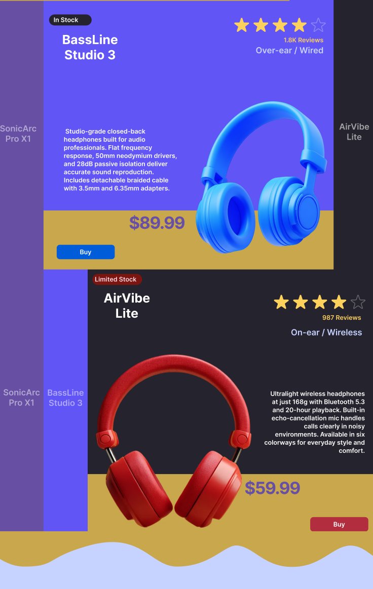
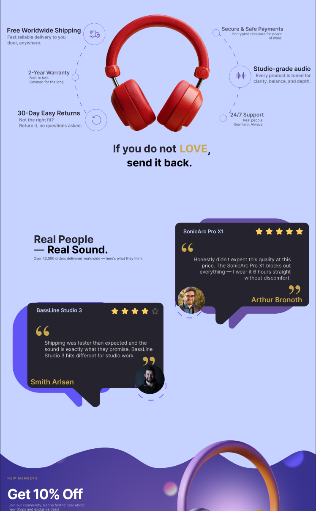

# 🎧 Headphonic — Sound Built Around You

A **design-focused, frontend-only landing page** for a fictional premium headphones store. The goal of this project is not functionality — it's a **high-quality end design**: a bold visual identity, carefully art-directed sections, custom illustration assets, and polished motion, all built with a modern frontend stack.

> Discover over 2,000 headphones — from everyday listening to studio-grade precision. Find the pair that fits your world.


---

## 📸 Screenshots

| Product Showcase — scroll-driven expanding cards |
|:---:|
|  |

| Value Proposition & Testimonials — benefit orbit + speech-bubble reviews |
|:---:|
|  |

---

## 🗺️ Page Sections

The page is composed of seven art-directed sections (`src/app/page.tsx`):

### 1. Hero
Purple wave backdrop with an oversized headphone render gliding in via GSAP once the image loads. Headline **"Sound Built Around You"** with a supporting paragraph and two CTAs (`Explore`, `Sign Up`). A floating navbar overlays the hero with logo, links, `Login` button, and a mobile hamburger.

### 2. Stats Bar
Social-proof strip: **12k+ Daily Orders**, **50K+ Registered Users**, and a **4.5★ rating from 42K+ reviews**, separated by rounded pill dividers (stacked 2-column layout on mobile).

### 3. Product Showcase
The centerpiece: a scroll-driven, accordion-style display where the **active product expands to full focus** while the others collapse into slim color-coded name strips. Each expanded card carries stock/limited badges, gold star ratings + review counts, category, a full product description, oversized price, and a brand-colored `Buy` button:

| Product | Category | Price | Rating |
|---|---|---:|:---:|
| **SonicArc Pro X1** — 40mm drivers · 40h battery · 35dB ANC | Over-ear / Wireless | $149.99 | ★★★★☆ (2.3K) |
| **BassLine Studio 3** — 50mm neodymium · flat response · 28dB isolation | Over-ear / Wired | $89.99 | ★★★☆☆ (1.8K) |
| **AirVibe Lite** — 168g · Bluetooth 5.3 · 20h playback | On-ear / Wireless | $59.99 | ★★★★☆ (987) |

### 4. Value Proposition
A red headphone render floats center-stage inside a soft radial glow, **surrounded by six benefit callouts** connected with dashed circular orbits — Free Worldwide Shipping, 2-Year Warranty, 30-Day Easy Returns, Secure & Safe Payments, Studio-grade Audio, and 24/7 Support — closing with the bold statement: **"If you do not LOVE, send it back."** On mobile the orbit collapses into a clean single column.

### 5. Testimonials
**"Real People — Real Sound."** Buyer reviews rendered as oversized chat speech-bubbles with layered colored backdrops, star ratings, avatar photos in dashed rings, and mirrored quote tails on each side of the grid.

### 6. Call To Action
A deep-purple radial-gradient band framed by SVG waves and floating glassy orbs. **"Get 10% Off"** email capture with a multi-layer animated `Claim Offer` button that sweeps through color reveals on hover ("Claim My 10%"), plus member perks: Exclusive Member Offers · Early Access to New Drops · Trusted by Audiophiles.

### 7. Footer
Stacked, rounded "arch" stripes rising behind a dark panel with social icons (Instagram / YouTube / X), `Explore` and `Support` link columns, a divider-lined credit row — **"Made with passion, by Crocoboy (Youssef)"** — and a giant responsive `HEADPHONIC` wordmark.

---

## 🎨 Design System

Defined as CSS-first theme tokens in `globals.css` (Tailwind v4):

| Token | Value | Usage |
|---|---|---|
| `primary` | `#6750A4` | Brand purple — CTAs, accents, scrollbar |
| `secondary` | `#6155F5` | Indigo — waves, footer layers |
| `tertiary` | `#C9A74D` | Gold — prices, stars, highlights |
| `neutral` | `#25232D` | Ink — text & dark surfaces |
| `light` | `#C6D2FF` | Periwinkle — soft text & borders |

**Typography:** Inter (400 / 600 / 700 / 900) with a custom display scale — `h1` 64px → `h2` 48px → `h3` 32px → `h4` 24px, body 16px, small 14px. Layout is capped at `max-w-7xl` with the footer's signature `rounded-[121px]` arches.

## ⚡ Motion & Interaction

- **GSAP 3** (`@gsap/react`) timelines for section-scoped entrance choreography — hero slide-in triggered by image load, staggered value-prop orbits, product card reveals, CTA element cascades
- **Lenis** smooth scrolling across the whole page
- Micro-interactions everywhere: layered button hover sweeps, dashed-orbit effect, icon transitions
- Custom thin purple scrollbar

## 🧱 Tech Stack

- [Next.js 16](https://nextjs.org) (App Router) + [React 19](https://react.dev)
- [TypeScript](https://www.typescriptlang.org)
- [Tailwind CSS v4](https://tailwindcss.com) — CSS-first `@theme` configuration, no config file
- [GSAP](https://gsap.com) + [@gsap/react](https://gsap.com/resources/React/)
- [Lenis](https://lenis.darkroom.engineering) — inertial smooth scroll
- [lucide-react](https://lucide.dev) icons, `clsx` + `tailwind-merge` for class management

> **Note:** This is a **frontend-only showcase** — no backend, commerce, or auth. All buttons and links are decorative placeholders, and products / reviews are fictional demo content.

## 🚀 Getting Started

```bash
# 1. Clone the repo
git clone https://github.com/Crocoboy000/headphonic.git
cd headphonic

# 2. Install dependencies
npm install

# 3. Run the dev server
npm run dev
```

Open [http://localhost:3000](http://localhost:3000) to see the result.

### Scripts

| Command | Description |
|---|---|
| `npm run dev` | Start the development server |
| `npm run build` | Create a production build |
| `npm start` | Serve the production build |
| `npm run lint` | Run ESLint |

## 📁 Project Structure

```
headphonic/
├── public/
│   ├── headphones/       # Section artwork (renders, waves, bubbles, dashes)
│   ├── cta/              # CTA band assets (waves, orbs, glow)
│   └── *.png             # README screenshots
├── src/
│   ├── app/
│   │   ├── layout.tsx    # Root layout, fonts, metadata, smooth scroll
│   │   ├── globals.css   # Design tokens & theme
│   │   └── page.tsx      # Section composition
│   ├── components/
│   │   ├── layout/       # Navbar, Footer, SmoothScroll (Lenis)
│   │   ├── sections/     # Hero, Stats, Products, ValueProposition,
│   │   │                 # Testimonials, Cta
│   │   └── ui/           # Button, Badge, TestimonialCard
│   └── utils/cn.ts       # clsx + tailwind-merge helper
└── README.md
```

## 🧑‍🎨 Author

Built with passion by **[Crocoboy (Youssef)](https://github.com/Crocoboy000)**.
